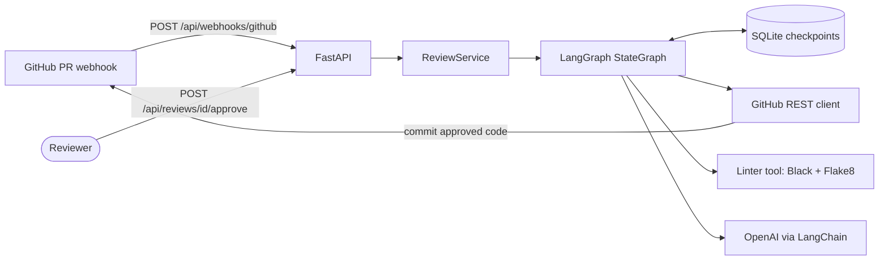
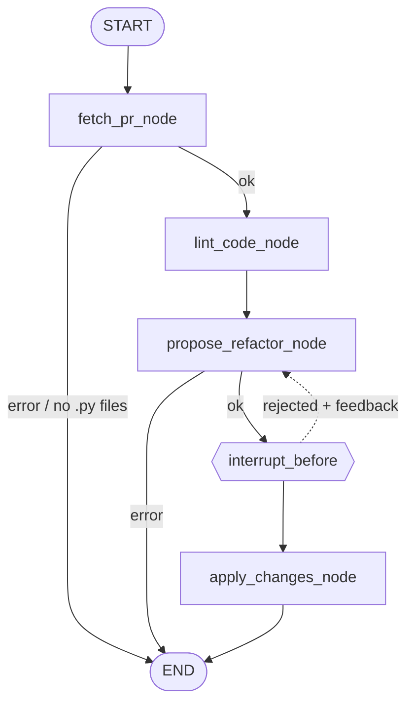
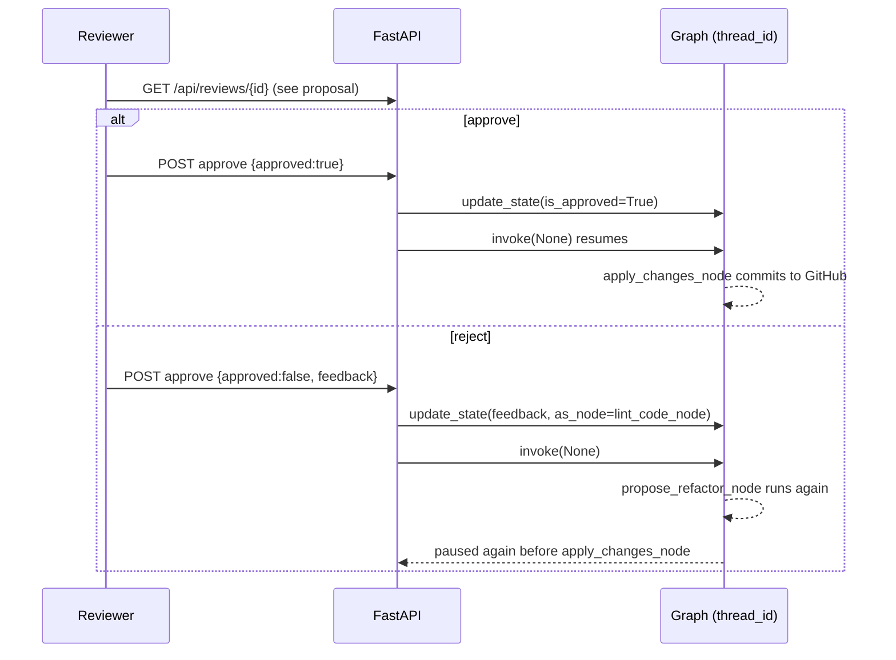

# Autonomous Code Review & Refactoring Agent (LangGraph)

An AI agent that receives GitHub pull-request webhooks, lints the changed Python
files with Black and Flake8, asks an LLM to refactor them, **pauses for a human
decision**, and only then commits the result back to the PR branch. All state is
checkpointed in SQLite, so reviews survive API calls and restarts.

## Business problem

Code review is slow and repetitive: reviewers spend time on formatting,
unused imports and style nits instead of design. Fully automated rewriting is
unsafe, since an LLM can subtly change behaviour. This project automates the
mechanical work while keeping a human in control: nothing is pushed without
explicit approval, and rejections feed reviewer feedback back into a new proposal.

## Key features

- LangGraph `StateGraph` with four nodes: fetch, lint, propose, apply.
- Human-in-the-loop via `interrupt_before=["apply_changes_node"]`.
- Rejection loop on the **same thread**: feedback is stored and the refactor node re-runs; the graph is never restarted.
- Persistent SQLite checkpointer (`SqliteSaver`), one `thread_id` per review.
- Sandboxed linter `@tool`: temp dir, no shell, timeouts, scrubbed environment, code is never executed.
- GitHub REST client with pagination, typed errors (auth, permission, 404, rate limit, conflict).
- FastAPI endpoints with Pydantic validation, HMAC webhook signature check, OpenAPI docs.
- Revision cap (`MAX_REVISIONS`, default 5) prevents endless reject loops.
- Test suite (no real GitHub/OpenAI needed), Dockerfile and Compose.

## System architecture



## LangGraph workflow



| Node | Responsibility |
|------|----------------|
| `fetch_pr_node` | Fetch PR, changed `.py` files (paginated), contents, head repo/branch, blob SHAs |
| `lint_code_node` | Run `run_linter_tool` per file; store results in `lint_errors` |
| `propose_refactor_node` | Prompt the LLM with code, lint results and `reviewer_feedback`; store `refactored_code` (and re-lint it) |
| `apply_changes_node` | Refuses unless `is_approved`; commits each changed file to the PR branch; records history |

State (`app/agents/state.py`, a `TypedDict`) contains the required keys
`pr_url, code_contents, lint_errors, refactored_code, is_approved,
reviewer_feedback, history` plus `thread_id, owner, repository, branch,
pull_number, file_paths, file_shas, revision_count, commits, execution_status,
error_message`. `history` uses an additive reducer, forming an audit trail.

## Human-in-the-loop



Because the graph is compiled with a checkpointer and `interrupt_before`, it stops
before `apply_changes_node`. The service resumes it with LangGraph's
`update_state(...)` + `invoke(None, config)`. A rejection rewinds the same thread
to just before `propose_refactor_node` by recording the update as if made by
`lint_code_node`, so history, fetched code and lint results are kept.

## Project structure

```
app/
  agents/      state.py, nodes.py, prompts.py, graph.py, checkpointer.py
  tools/       linter_tool.py
  github/      github_client.py
  api/         webhooks.py, reviews.py, schemas.py, deps.py
  services/    review_service.py
  config.py
tests/         test_graph.py, test_linter.py, test_webhooks.py, test_approval.py, test_github_client.py
scripts/       export_openapi.py
main.py  Dockerfile  docker-compose.yml  openapi.json  requirements.txt  pytest.ini
```

## Technology stack

Python 3.11+, LangGraph, LangChain / LangChain Core, `langchain-openai`,
`langgraph-checkpoint-sqlite`, FastAPI, Uvicorn, Pydantic (+ pydantic-settings),
GitHub REST API (`requests`), Black, Flake8, Pytest, python-dotenv, Docker.

## Installation

```bash
python -m venv .venv
source .venv/bin/activate          # Windows: .venv\Scripts\activate
pip install -r requirements.txt
cp .env.example .env               # then fill in the values
```

## Environment variables

| Variable | Description |
|----------|-------------|
| `GITHUB_TOKEN` | GitHub token used to read PRs and commit |
| `GITHUB_API_URL` | Default `https://api.github.com` (change for GitHub Enterprise) |
| `GITHUB_WEBHOOK_SECRET` | Shared secret for `X-Hub-Signature-256` verification |
| `OPENAI_API_KEY` | OpenAI API key |
| `OPENAI_MODEL` | Default `gpt-4o-mini` |

Optional: `CHECKPOINT_DB_PATH` (default `data/checkpoints.sqlite`),
`MAX_REVISIONS` (5), `MAX_FILE_BYTES` (200000), `MAX_FILES_PER_PR` (20).
Secrets are held as `SecretStr` and never logged. `.env` is git-ignored.

## GitHub token setup

1. GitHub → Settings → Developer settings → Personal access tokens → Fine-grained tokens.
2. Select the target repositories.
3. Grant **Contents: Read and write** and **Pull requests: Read**.
4. Put the token in `GITHUB_TOKEN`. (Classic tokens need the `repo` scope.)

For PRs from forks the token can only commit if the fork permits maintainer edits.

## OpenAI API setup

Create a key at <https://platform.openai.com/api-keys>, set `OPENAI_API_KEY`, and
optionally change `OPENAI_MODEL`.

## Running the application

```bash
uvicorn main:app --host 0.0.0.0 --port 8000
```

Swagger UI: <http://localhost:8000/docs>. To receive webhooks locally, expose the
port (e.g. `ngrok http 8000`).

## Docker setup

```bash
cp .env.example .env     # fill in secrets
docker compose up --build
curl http://localhost:8000/health
```

Checkpoints are stored in the named volume `checkpoint-data` mounted at `/data`,
so they survive container restarts. The container runs as a non-root user and has
a health check.

## GitHub integration setup

Repository → Settings → Webhooks → Add webhook:

- Payload URL: `https://<your-host>/api/webhooks/github`
- Content type: `application/json`
- Secret: the value of `GITHUB_WEBHOOK_SECRET`
- Events: **Pull requests**

Handled actions: `opened`, `synchronize`, `reopened`, `ready_for_review`. Others
and non-PR events are acknowledged and ignored; `ping` returns `pong`.

## API endpoints

| Method | Path | Description |
|--------|------|-------------|
| POST | `/api/webhooks/github` | Receive PR event, start review (202) |
| GET | `/api/reviews/{thread_id}` | Status, lint results, proposal, history |
| POST | `/api/reviews/{thread_id}/approve` | Approve or reject |
| GET | `/health` | Liveness probe |

Statuses: `processing`, `awaiting_approval`, `completed`, `skipped`, `error`.
Errors: 401 bad signature, 404 unknown thread, 409 not awaiting approval or
revision limit hit, 422 invalid payload, 502 GitHub commit failed. The full
specification is in [`openapi.json`](openapi.json) (regenerate with
`python -m scripts.export_openapi`).

Webhook processing runs as a background task so GitHub's 10-second delivery
timeout is respected; poll `GET /api/reviews/{thread_id}` for progress.

### Example webhook request

```bash
curl -X POST http://localhost:8000/api/webhooks/github \
  -H "X-GitHub-Event: pull_request" -H "Content-Type: application/json" \
  -d '{
    "action": "opened", "number": 7,
    "pull_request": {"number": 7, "html_url": "https://github.com/octo/demo/pull/7",
                     "head": {"ref": "feature", "repo": {"full_name": "octo/demo"}}},
    "repository": {"name": "demo", "full_name": "octo/demo",
                   "html_url": "https://github.com/octo/demo", "owner": {"login": "octo"}}
  }'
# {"thread_id":"octo-demo-pr7-1a2b3c4d","status":"processing","message":"..."}
```

(When `GITHUB_WEBHOOK_SECRET` is set, requests must carry a valid `X-Hub-Signature-256`.)

### Example approval request

```bash
curl -X POST http://localhost:8000/api/reviews/octo-demo-pr7-1a2b3c4d/approve \
  -H "Content-Type: application/json" -d '{"approved": true, "feedback": ""}'
```

### Example rejection request

```bash
curl -X POST http://localhost:8000/api/reviews/octo-demo-pr7-1a2b3c4d/approve \
  -H "Content-Type: application/json" \
  -d '{"approved": false, "feedback": "Use list comprehensions instead of loops"}'
```

The response contains the new proposal and `status: "awaiting_approval"`.
Feedback is mandatory when rejecting.

## Running automated tests

```bash
pytest
```

All external services (GitHub, OpenAI) are faked, so no credentials are needed.
Black and Flake8 are run for real in the linter tests. Coverage: linter isolation
and cleanup, graph execution and the interrupt, rejection loop on one thread,
approval and commit, restart persistence, GitHub client errors/pagination, and all
API endpoints including invalid payloads, unknown threads and GitHub failures.
The suite takes a couple of minutes because each lint spawns Black and Flake8.

## Security considerations

- Linter never imports, executes, `eval`s or `exec`s submitted code; it runs only `black --check` and `flake8` as argument lists (`shell=False`) with a 30 s timeout.
- Each run uses a fresh temporary directory (deleted afterwards) and a scrubbed environment containing no API keys; POSIX runs also get CPU, memory and file-size `rlimit`s.
- Webhook payloads are HMAC-verified (constant-time compare) when a secret is configured. **Set a secret in production**; without it, a warning is logged and any caller can trigger reviews.
- Secrets are `SecretStr`, loaded from the environment, and never logged.
- Commits happen only after explicit approval; `apply_changes_node` re-checks `is_approved` itself.
- The API itself has **no authentication** on the approval endpoints. Put it behind an authenticating proxy or add auth before exposing it publicly.
- LLM output is untrusted: it is re-linted and shown to a human before any commit.

## Future improvements

- Authentication/authorisation for reviewers, and a small review UI showing diffs.
- Retry path after a failed commit (currently a failed apply ends the thread in `error`).
- Single atomic multi-file commit via the Git Data API instead of one commit per file.
- Semantic equivalence checks (run the project's tests on the proposal in a stronger sandbox, e.g. a container).
- Post the proposal as a PR comment; durable job queue instead of FastAPI background tasks.
- Support for more languages and linters.
